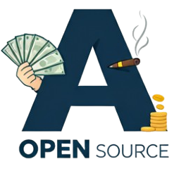
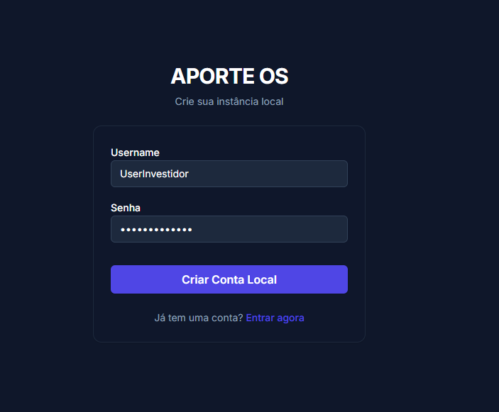
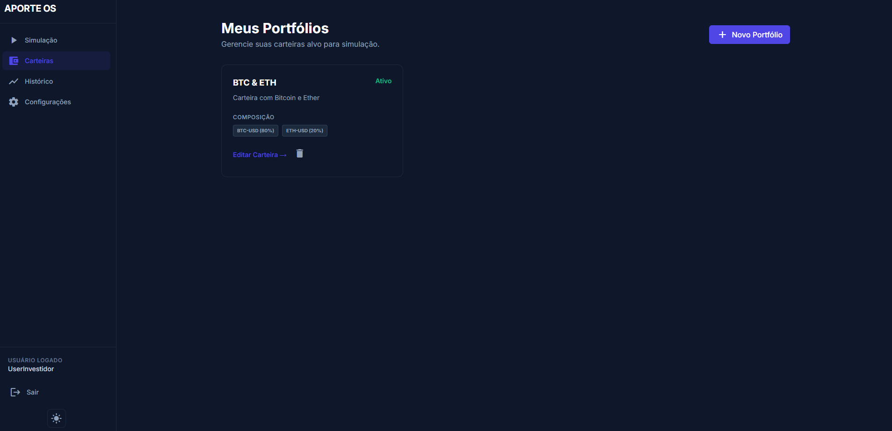
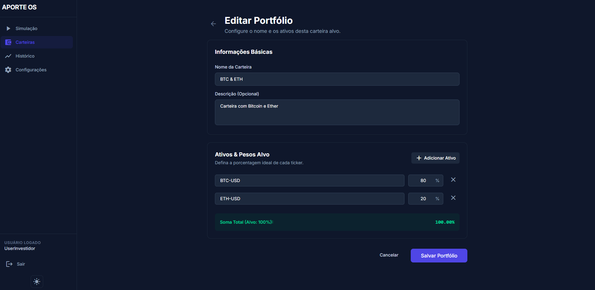
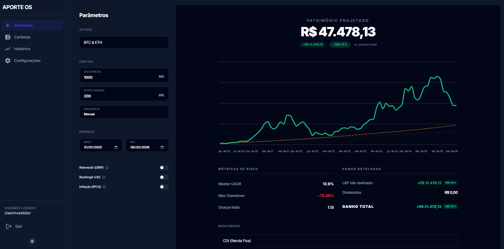
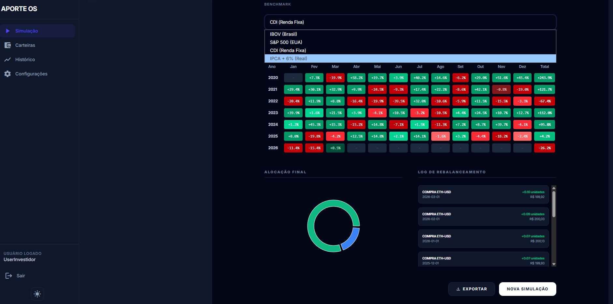
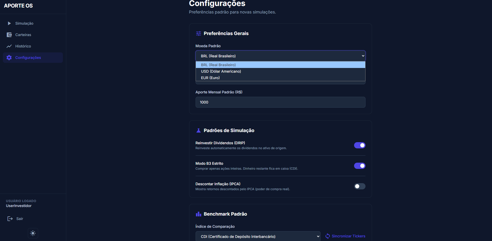
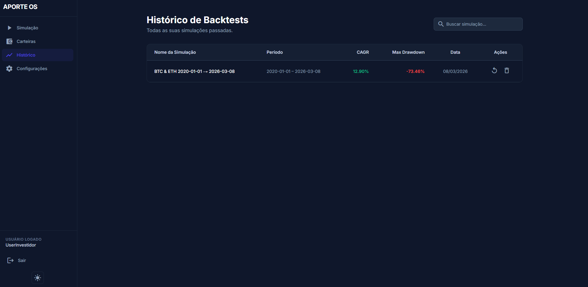

<div align="center">
  
  <h1>Aporte OSS</h1>
  <p><strong>Open-source, self-hosted platform for portfolio rebalancing and backtesting.</strong></p>
  <p>
    <a href="LICENSE"></a>
  </p>
</div>

## Why Aporte

Aporte was built for a specific need of individual investors: **simulating real monthly contributions with active rebalancing**.
Most backtesters only show lump-sum returns. Aporte computes what actually happens when you invest new money every month and use it to buy the asset that is *lagging behind* its target weight (rebalancing through contributions).

It is fully **self-hosted**, so your data stays private: no SaaS, no cloud sync, no third-party tracking. Your financial data lives only on your machine.

## Features

- **Flexible backtesting**: simulates **monthly, biweekly or weekly** contributions and computes real (inflation-adjusted) gains.
- **Rebalancing engine**: detects weight deficits automatically and buys the assets below target with each contribution.
- **Benchmarks**: compare your portfolio against **IBOV, S&P 500, CDI (Selic)** or **IPCA + 6%** (real return).
- **Multiple asset classes**: pulls free historical data from Yahoo Finance for Brazilian (B3) and US stocks, BDRs, cryptocurrencies and ETFs.
- **Dividend reinvestment (DRIP)**: reinvest dividends automatically or keep them as cash.
- **Redis cache**: a built-in cache layer that avoids rate limiting and brings simulations under 50 ms.
  - **Efficiency**: a *cache-aside* pattern stores historical series in Redis. This avoids repeated calls to the Yahoo Finance and Central Bank of Brazil (SGS) APIs, protects against IP blocks and makes repeated queries instant.
  - **TTLs**: historical series (24 h), dividends (24 h), real-time quotes (5 min) and macro data from the Central Bank (1 week).
- **Privacy first**: local SQLite database and self-hosted NextAuth credentials. You are the only administrator.

---

## Concepts and glossary

The simulation engine rests on a few financial ideas:

### Rebalancing through contributions
This is the core of the project. Traditional rebalancing sells the assets that went up to buy the ones that went down. **Rebalancing through contributions** uses only new money (your monthly contribution) to buy the assets with the largest deficit against the target. That avoids taxes on sales and cuts brokerage costs.

### Performance metrics
- **CAGR (Compound Annual Growth Rate)**: the average yearly return of the portfolio over the simulated period, with compounding.
- **Max drawdown**: the largest peak-to-trough fall of the portfolio. It is the plainest measure of psychological risk: how far could you watch your savings drop without panicking?
- **Sharpe ratio**: excess return relative to volatility. The higher it is, the more return you got for the risk you took.

### Glossary
- **DRIP (Dividend Reinvestment Plan)**: reinvesting every dividend and interest on equity (JCP) right away to speed up compounding.
- **Benchmark / opportunity cost**: the index used to compare your portfolio (for example: "did my portfolio beat the CDI or the Ibovespa?"). In the chart it is the **orange line**.
- **B3 strict mode**: a simulation mode that only buys whole lots (multiples of 1 or 100, following B3 rules), reproducing the cases where fractional shares cannot be bought.
- **IPCA (inflation)**: Brazil's consumer price index. When enabled, the engine discounts it from the final value to show your **real gain** (purchasing power).

---

## Visual tour

### 1. Private authentication
Aporte is **self-hosted**. On first start you create a local account that lives only in your database. Your financial data never leaves your machine.



### 2. Portfolio management
Create and edit target portfolios by setting a percentage weight for each asset. Brazilian stocks, REITs (FIIs), crypto and US stocks are supported.

<div align="center">
  
  
</div>

*Left: saved portfolios. Right: the asset and weight editor.*

### 3. Simulation engine (backtesting)
The heart of the project. Adjust the contribution, frequency and period to see how your savings would have grown.



*Interactive chart comparing portfolio value (green), invested capital (gray) and the benchmark / opportunity cost (orange).*

### 4. Insights and metrics
Analyze performance with monthly heatmaps and see exactly where the rebalancing algorithm bought.



*Benchmark dropdown and a color-coded heatmap to spot high- and low-volatility months.*

### 5. Settings and history
Set your default currency, benchmarks and contribution rules (DRIP, B3 mode). Every simulation is saved for quick reference.

<div align="center">
  
  
</div>

---
## Supported assets

A pre-loaded database powers the search auto-complete. More than 140 assets are supported today:

<details>
<summary><b>📂 Click to expand: B3 stocks (IBOV + IBRX + small caps)</b></summary>

| Ticker | Name | Ticker | Name |
|:---:|:---|:---:|:---|
| RRRP3 | 3R Petroleum | ALPA4 | Alpargatas |
| ABEV3 | Ambev | AMER3 | Americanas |
| ARZZ3 | Arezzo | ASAI3 | Assaí |
| AZUL4 | Azul | B3SA3 | B3 |
| BBAS3 | Banco do Brasil | BBSE3 | BB Seguridade |
| BBDC3 | Bradesco ON | BBDC4 | Bradesco PN |
| BRAP4 | Bradespar | BRFS3 | BRF |
| BPAC11 | BTG Pactual | CRFB3 | Carrefour Brasil |
| CCRO3 | CCR | CMIG4 | Cemig |
| CIEL3 | Cielo | COGN3 | Cogna |
| CPLE6 | Copel | CSAN3 | Cosan |
| CPFE3 | CPFL Energia | CVCB3 | CVC |
| CYRE3 | Cyrela | DXCO3 | Dexco |
| ELET3 | Eletrobras ON | ELET6 | Eletrobras PN |
| EMBR3 | Embraer | ENGI11 | Energisa |
| ENEV3 | Eneva | EGIE3 | Engie |
| EQTL3 | Equatorial | EZTC3 | EZTEC |
| FLRY3 | Fleury | GGBR4 | Gerdau |
| GOAU4 | Gerdau Metalúrgica | GOLL4 | Gol |
| HAPV3 | Hapvida | HYPE3 | Hypera |
| IGTI11 | Iguatemi | IRBR3 | IRB Brasil |
| ITSA4 | Itaúsa | ITUB4 | Itaú Unibanco |
| JBSS3 | JBS | KLBN11 | Klabin |
| RENT3 | Localiza | LREN3 | Lojas Renner |
| LWSA3 | Locaweb | MGLU3 | Magazine Luiza |
| MRVE3 | MRV | BEEF3 | Minerva |
| MULT3 | Multiplan | NTCO3 | Natura |
| PETR3 | Petrobras ON | PETR4 | Petrobras PN |
| PRIO3 | PetroRio | PETZ3 | Petz |
| RADL3 | RaiaDrogasil | RAIZ4 | Raízen |
| RDOR3 | Rede D'Or | RAIL3 | Rumo |
| SBSP3 | Sabesp | SANB11 | Santander |
| SMTO3 | São Martinho | CSNA3 | Siderúrgica Nacional |
| SLCE3 | SLC Agrícola | SUZB3 | Suzano |
| TAEE11 | Taesa | VIVT3 | Telefônica Brasil |
| TIMS3 | TIM | TOTS3 | Totvs |
| UGPA3 | Ultrapar | USIM5 | Usiminas |
| VALE3 | Vale | VAMO3 | Grupo Vamos |
| VBBR3 | Vibra Energia | WEGE3 | WEG |
| YDUQ3 | Yduqs | | |

</details>

<details>
<summary><b>📂 Click to expand: Brazilian REITs (FIIs)</b></summary>

| Ticker | Name | Ticker | Name |
|:---:|:---|:---:|:---|
| MXRF11 | Maxi Renda | HGLG11 | CGHG Logística |
| KNRI11 | Kinea Renda | XPLG11 | XP Log |
| XPIN11 | XP Industrial | VISC11 | Vinci Shopping |
| HGRE11 | HG Real Estate | HGBS11 | Hedge Brasil Shopping |
| BTLG11 | BTG Pactual Log | RECR11 | Recv Recebíveis |
| CPTS11 | Capitânia Securities | IRDM11 | Iridium Recebíveis |
| KNCR11 | Kinea Rendimentos | ALZR11 | Alianza Trust Renda |
| BCFF11 | BTG Fundo de Fundos | HSML11 | HSI Malls |
| MALL11 | Malls Brasil Plural | TRXF11 | TRX Real Estate |
| LVBI11 | VBI Logística | VILG11 | Vinci Logística |

</details>

<details>
<summary><b>📂 Click to expand: Cryptocurrencies</b></summary>

| Ticker | Name | Ticker | Name |
|:---:|:---|:---:|:---|
| BTC | Bitcoin | ETH | Ethereum |
| SOL | Solana | XRP | XRP |
| BNB | BNB | ADA | Cardano |
| DOGE | Dogecoin | DOT | Polkadot |
| MATIC | Polygon | LINK | Chainlink |
| DAI | Dai | LTC | Litecoin |
| BCH | Bitcoin Cash | SHIB | Shiba Inu |
| UNI | Uniswap | AVAX | Avalanche |
| XLM | Stellar | ATOM | Cosmos |
| NEAR | NEAR Protocol | LDO | Lido DAO |
| VET | VeChain | INJ | Injective |
| RNDR | Render | FET | Fetch.ai |
| PEPE | Pepe | | |

</details>

<details>
<summary><b>📂 Click to expand: ETFs and indices</b></summary>

| Ticker | Name |
|:---:|:---|
| BOVA11 | iShares Ibovespa |
| SMAL11 | iShares Small Cap |
| IVVB11 | iShares S&P 500 |
| HASH11 | Hashdex Nasdaq Crypto |
| QBTC11 | QR Bitcoin ETF |
| QETH11 | QR Ethereum ETF |
| USTBRL=X | US dollar / Brazilian real |
| ^BVSP | Ibovespa |
| ^GSPC | S&P 500 |

</details>

---

## Running it

The math engine (Python, FastAPI) and the frontend (Next.js) are packaged together with Docker, so one command starts everything.

### Requirements
- [Docker](https://docs.docker.com/get-docker/) installed and running.

### Install

Clone the repository and run the start script from the root:

```bash
git clone https://github.com/brennocm/aporte.git
cd aporte
```

**Linux / macOS:**
```bash
./start.sh
```

**Windows (PowerShell):**
```powershell
.\start.ps1
```

*The script generates your credentials in `.env`, builds the Docker images and starts the local environment.*

> **Stop**: to stop the containers cleanly and free memory, run `./stop.sh` or `.\stop.ps1`.

> **Reset**: to clear the math cache (Redis) and rebuild the infrastructure without losing your database, run `./reset.sh` or `.\reset.ps1`.

### Access
Open [http://localhost:3000](http://localhost:3000) in your browser.

1. Create a local account on the sign-up page.
2. Sign in and start simulating.

### Environment variables (.env)

`start.sh` generates these for you.

| Variable | Description | Default |
|:--- |:--- |:--- |
| `AUTH_SECRET` | Session encryption key (NextAuth) | *Generated at setup* |
| `NEXT_PUBLIC_API_URL` | URL of the math engine | `http://math-engine:8000` |
| `DATABASE_URL` | Database connection string | `file:./dev.db` |
| `REDIS_HOST` | Redis host for the cache | `redis` |

---

## Architecture

Aporte is a full-stack monorepo managed with Turborepo:

- **Frontend (`apps/web`)**: Next.js 15 (App Router), Tailwind CSS v4, Recharts.
- **Component library (`packages/ui`)**: shared design system.
- **Database**: local SQLite through Prisma ORM.
- **Math engine (`services/math-engine`)**: Python 3.11, FastAPI, Pandas, yfinance.
- **Cache**: Redis.

---

## Troubleshooting

### Docker failed to start?
Make sure ports `3000` (web), `8000` (math engine) and `6379` (Redis) are free. Try `docker compose down -v` to clean up orphaned volumes.

### Yahoo Finance rate limit error?
Aporte caches in layers, but if you simulate 50 different assets in one minute, Yahoo may block your IP for a while. Wait 15 minutes or use a VPN.

### How do I reset the database?
Delete `apps/web/prisma/dev.db` and run the setup again.

## License

Licensed under the **AGPL-3.0**. See [LICENSE](LICENSE).
